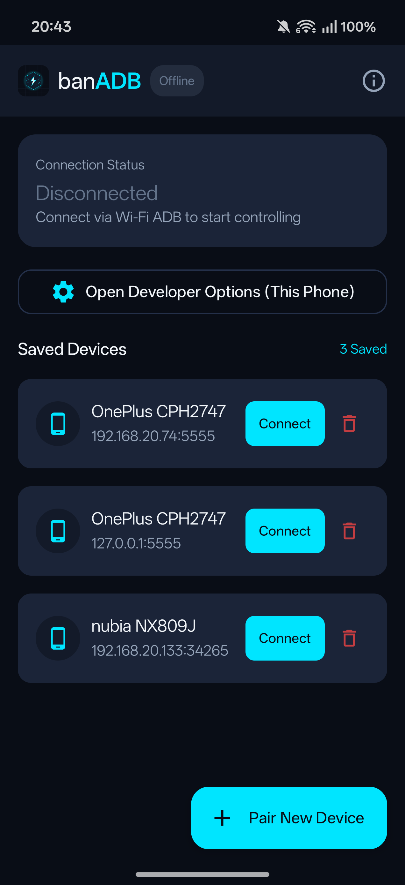
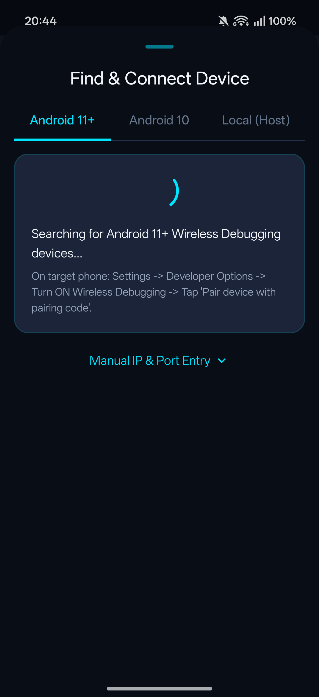
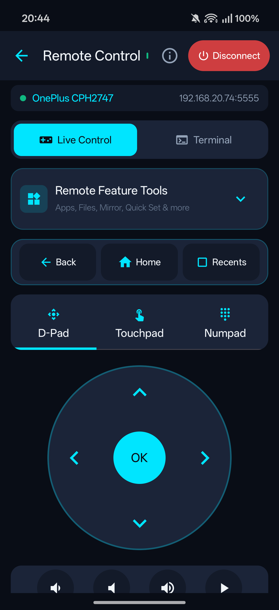
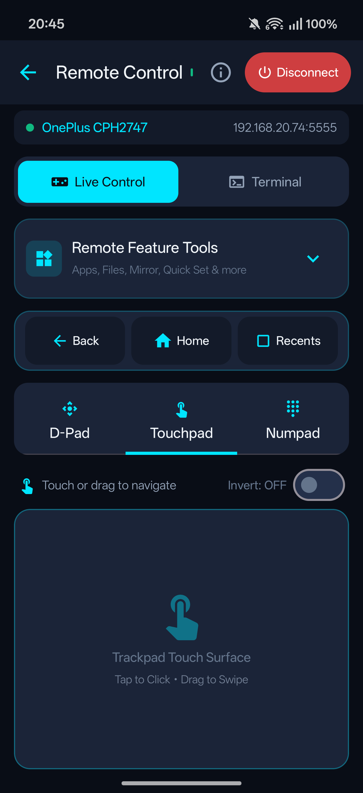
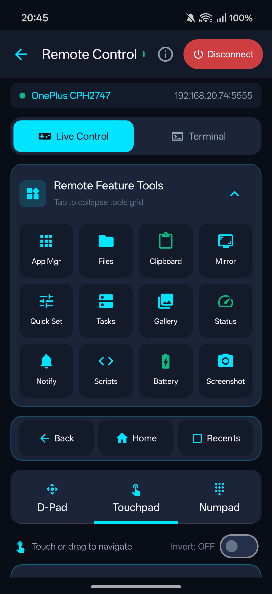
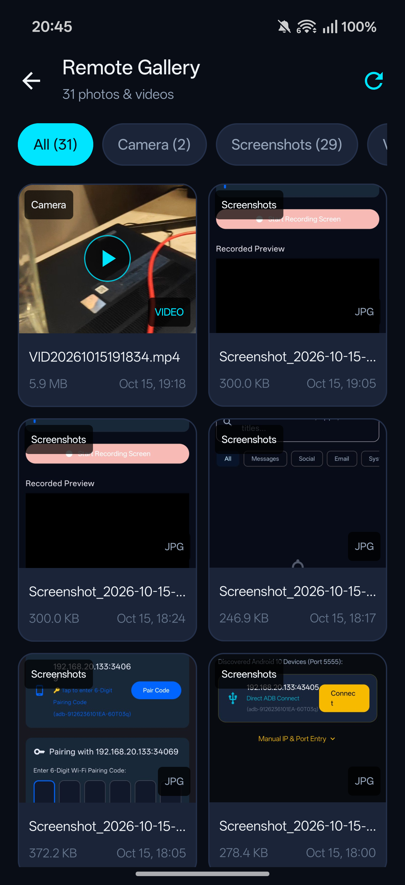
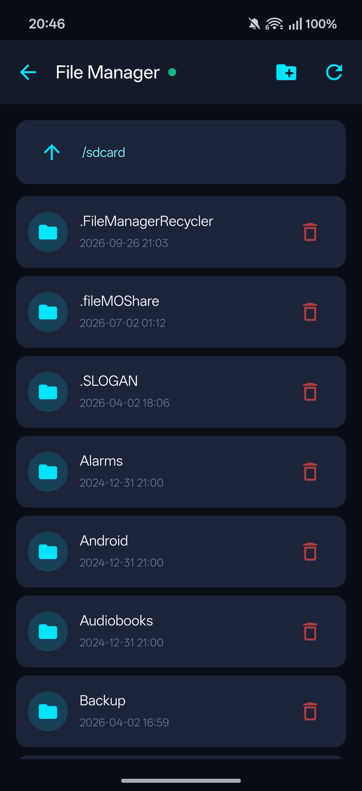
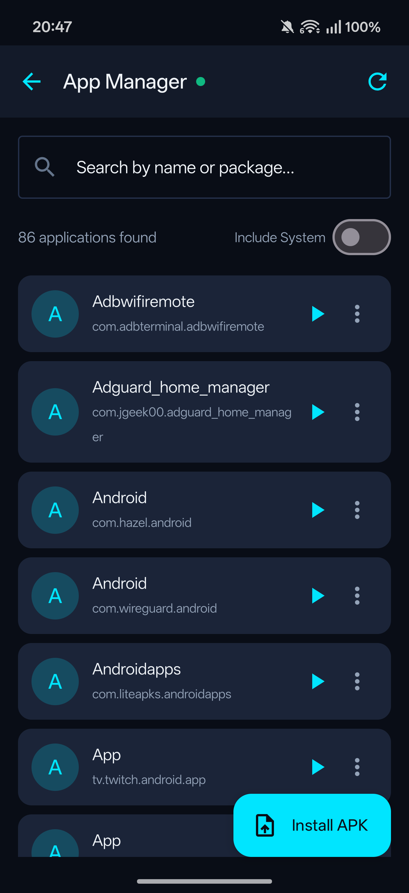
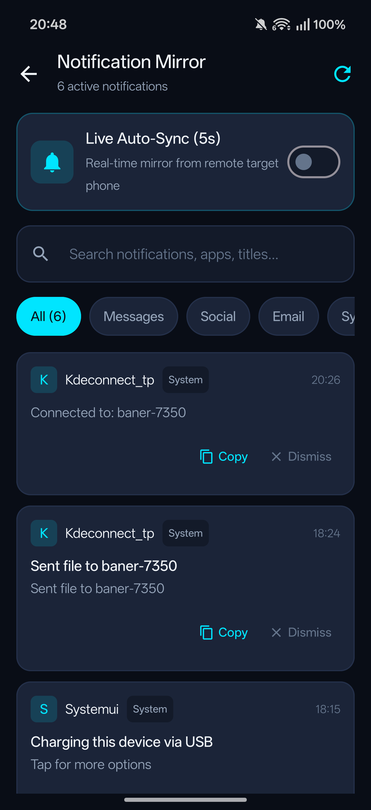

# banADB

<p align="center">
  
</p>

<p align="center">
  <b>Wireless Android-to-Android ADB remote cockpit & device manager.</b><br>
  No computer required. No root needed.
</p>

<p align="center">
  <a href="#downloads--installation">Downloads</a> •
  <a href="#features">Features</a> •
  <a href="USAGE.md">User Guide</a> •
  <a href="#building-from-source">Development</a> •
  <a href="#license">License</a>
</p>

---

## Screenshots

| Devices & Home | Wireless Pairing | Remote Control (D-Pad) |
|:---:|:---:|:---:|
|  |  |  |

| Trackpad Mode | Feature Tools Panel | Remote Gallery & Thumbnails |
|:---:|:---:|:---:|
|  |  |  |

| Remote File Manager | App Manager (APK Install/Extract) | Notification Mirror |
|:---:|:---:|:---:|
|  |  |  |

---

## Features

- **Wireless Pairing (Android 11+):**
  - Automatic local network discovery via mDNS.
  - Quick pairing with standard 6-digit Wi-Fi pairing code.
  - Manual IP and port input support for custom networks.
- **Classic ADB Connection (Android 10 & below):**
  - Connect directly to port `5555` on rooted devices or devices pre-configured with `adb tcpip 5555`.
  - Local loopback connection support (`127.0.0.1:5555`) to control or script the host phone itself.
- **Interactive Remote Cockpit:**
  - **D-Pad Mode:** 4-way directional pad with center OK button for menu navigation, smart TVs, or media boxes.
  - **Trackpad Mode:** Touch surface mapping swipes and taps to cursor touch events on the remote screen, with an invert scroll/drag toggle.
  - **Numpad & Text Injection:** Numeric keypad for PINs plus a direct text input field (`input text`) to send long URLs and strings without manual typing.
  - **System Navigation Keys:** Dedicated buttons for Back, Home, Recents, Power, Volume (+ / - / Mute), and Media Play/Pause.
- **Remote Gallery with Live Thumbnails:**
  - Browse photos and videos stored in `DCIM/` and `Pictures/` without downloading entire files first.
  - Fast thumbnail generation streamed over ADB.
  - Fullscreen preview with media metadata (dimensions, file size, timestamp).
- **Remote File Explorer:**
  - Browse internal storage (`/sdcard`) with breadcrumb navigation.
  - Create directories, delete files/folders, and inspect sizes and dates.
  - Download and open files locally with your device's default viewers.
  - One-tap APK installation directly from the file browser.
- **Application Manager:**
  - Search installed apps with quick filters (all packages vs. user-installed only).
  - Launch apps, force stop, or clear application data remotely.
  - **APK Extraction:** Pull the base APK file from the remote target directly into your local `/sdcard/Download/banADB/` folder.
  - **Remote APK Installation:** Pick any APK file from your phone and install it remotely via ADB package manager (`pm install -r`).
- **Live Notification Mirroring:**
  - View incoming active notifications from the remote phone sorted by category (Messages, Social, Email, System).
  - Auto-Sync mode refreshing every 5 seconds.
  - Copy notification text or dismiss notifications remotely.
- **Clipboard Bridge:**
  - Inspect current clipboard contents on the remote phone.
  - Push clipboard text from your device directly into the remote clipboard.
- **Terminal & Fast Scripts:**
  - Built-in interactive console for custom `sh` and `adb shell` commands.
  - Quick-action chips for frequent queries (`pm list packages`, `dumpsys battery`, `getprop`, `logcat`, etc.).
  - Save and run custom shell scripts.
- **Battery & Device Diagnostics:**
  - Real-time battery stats: percentage, charging status, temperature in °C, voltage, and health.
  - Hardware specs: manufacturer, model, Android version, SDK level, display resolution, and uptime.
- **Foreground Connection Service:**
  - Persistent background service keeps the ADB socket open when switching between apps or locking the screen.

For step-by-step instructions on every feature, read the full [User Guide (USAGE.md)](USAGE.md).

---

## Downloads & Installation

### GitHub Releases
Pre-compiled, ready-to-install APKs are published on the releases page:

👉 **[Download banADB from GitHub Releases](https://github.com/XbanerX/banADB/releases)**

1. Download `banadb.apk` on your Android device.
2. Open the downloaded file and grant permission to install unknown apps if prompted by your browser or file manager.
3. Launch banADB and start pairing your devices.

### F-Droid
> ⏳ **Coming soon to F-Droid:** Inclusion in the official F-Droid repository is currently in progress for automated open-source updates.

---

## Building from Source

If you want to build banADB yourself or contribute to the project:

### Prerequisites
- **Git**
- **JDK 17** (OpenJDK 17 recommended)
- **Android SDK** with build tools (API level 34+)
- Internet connection for Gradle dependencies

### Compilation Steps

1. **Clone the repository:**
   ```bash
   git clone https://github.com/XbanerX/banADB.git
   cd banadb
   ```

2. **Set your Java path:**
   Make sure `JAVA_HOME` points to your JDK 17 installation:
   ```bash
   export JAVA_HOME=/usr/lib/jvm/java-17-openjdk
   ```

3. **Build the debug APK:**
   ```bash
   ./gradlew assembleDebug
   ```

4. **Locate the APK:**
   Once compilation completes, the APK is located at:
   ```
   app/build/outputs/apk/debug/app-debug.apk
   ```

5. **Install on a test device:**
   ```bash
   adb install -r app/build/outputs/apk/debug/app-debug.apk
   ```

### Building a signed release APK (optional)

Release signing is optional and driven by environment variables (the keystore
password is never stored in the repository). Place your keystore as
`app/banadb-release.jks`, then run:

```bash
export BANADB_STORE_PASSWORD=your_store_password
export BANADB_KEY_ALIAS=banadb          # optional, defaults to "banadb"
export BANADB_KEY_PASSWORD=your_key_password
./gradlew assembleRelease
```

If the keystore or credentials are missing, Gradle produces an unsigned APK
(which is what F-Droid does; F-Droid signs the APK with its own key).

---

## License

This project is licensed under the [GNU Affero General Public License v3.0 (AGPL-3.0)](https://www.gnu.org/licenses/agpl-3.0.html).

Full license text is available locally in [LICENSE](./LICENSE) and [LICENSE.md](./LICENSE.md), or online at [gnu.org/licenses/agpl-3.0](https://www.gnu.org/licenses/agpl-3.0.html).

